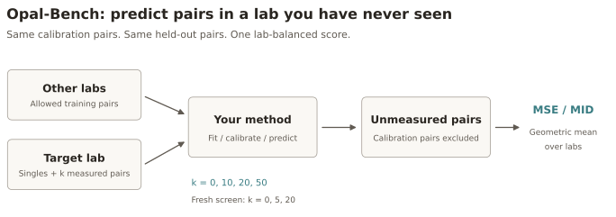
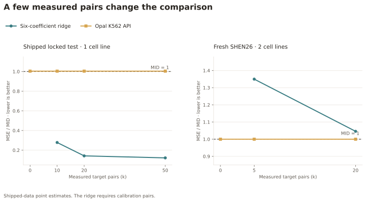

<div align="center">
  
  <h1>Opal-Bench</h1>
  <p>Predict combinatorial CRISPR growth in a lab you have never seen.</p>
</div>

<div align="center">
  <a href="https://thetinyintelligencelab.vercel.app/"></a>
  <a href="LICENSE"></a>
  <a href="DATA_LICENSES.md"></a>
</div>

<p align="center">
  <a href="#how-it-works">Benchmark</a> &middot;
  <a href="#install">Quick start</a> &middot;
  <a href="#results">Results</a> &middot;
  <a href="#submit-a-method">Submit a method</a> &middot;
  <a href="#data-and-reproduction">Data</a> &middot;
  <a href="https://huggingface.co/datasets/TheTinyIntelLab/opal-bench">Hugging Face</a> &middot;
  <a href="#citation">Citation</a>
</p>

Opal-Bench tests whether a method can predict pair growth in a held-out CRISPR screen from single-gene scores and up to k measured pairs. The full benchmark covers 411,098 pairs across 22 labs, spanning CRISPRi, Cas9, paired Cas9, Cas12a and CHyMErA. The public checkout ships 334,669 pairs from 17 labs and aggregate results for the five restricted labs.

## How it works



| Track | Evaluation units | Allowed training | k | Draws |
| --- | --- | --- | --- | --- |
| Development | 18 labs | Other development labs | 0, 10, 20, 50 | 20 |
| Locked test | 4 labs, 31 cell lines | 18 development labs | 0, 10, 20, 50 | 20 |
| Fresh SHEN26 | 2 cell lines | Labs in the benchmark table | 0, 5, 20 | 50 |

Methods share calibration draws, and scores exclude the calibration pairs. At k = 0 the scorer uses one draw. The main score geometrically averages MSE/MSE(MID) across draws, cell lines and labs, with equal weight per lab. MID is the mean of ADD and MIN. Rank intervals use 2,000 bootstrap replicates. Bootstrap resampling covers labs, then cell lines where applicable.

For each screen, compute log2 fold change from CPM, center on controls or singles, then divide by the negative fifth percentile of single-gene log fold changes, floored at 0.1. ADD sums the two singles. MIN takes the smaller single.

The [leaderboard](leaderboard/LEADERBOARD.md) also covers zero-shot held-out-lab prediction (`a`), 20-pair calibration (`a_fs20`), held-out genes (`b`), strong-negative interaction AUROC (`c`) and cross-lab reproducibility (`d`).

### Supplemental tracks

- **Unseen genes.** Report MSE when one, two or either gene is absent from training and the current calibration draw. The K562 API roster includes checkpoint training genes and excludes the source lab from scoring.
- **Top-5% hits.** Rank pair growth minus additive growth and report precision and recall for the two tails, synergy and buffering. Round the tail sizes up and break ties by pair key.
- **Uncertainty.** Return `opal_bench.fewshot.Prediction(point, lower, upper)` for 90% intervals. The scorer reports coverage and mean width. `--baseline-intervals` estimates residual bands from target calibration pairs, holding out half for fitted baselines. `--training-intervals` uses an eligible training screen when the target has too few pairs and labels those results `training_screen`.
  The residual radius is the absolute error at rank `ceil(0.90 * (m + 1))` among `m` held-out residuals. A finite target-screen band requires at least nine residuals. The training-screen fallback selects the largest eligible source, excluding the frozen checkpoint's source screen. Fixed baselines use the entire source screen for residuals. Adaptive baselines fit on k source pairs and use the rest for residuals. The fallback leaves point predictions unchanged. Its observed coverage measures transfer to the target screen.
- **Rolling prospective.** Freeze the submission before pair outcomes become public. See the [eligibility and scoring protocol](PROSPECTIVE.md).

Supplemental metrics average draws within cell lines, then cell lines within labs, then labs. Empty unseen-gene cohorts are omitted from their cohort mean. Predicted and measured hit sets have the same size, so precision and recall coincide within each tail.

## Install

Use Python 3.10 or newer. Create a virtual environment with `python -m venv .venv`, activate it for your shell, then run:

```bash
python -m pip install -e ".[test]"
python -X utf8 -m pytest -q
opal-bench-score fewshot
opal-bench-score tasks
opal-bench-score tracks --split test --budget 20 --baseline-intervals --training-intervals
opal-bench-score table leaderboard/rows.csv.gz
```

The import is `opal_bench`. The tests reproduce the shipped baseline scores, published leaderboard tables and auxiliary tasks. To regenerate the figures, install Matplotlib and run `python tools/plot_readme.py`.

## Results

Of the two networks on the locked test, only NET_ATT's rank interval overlaps the six-coefficient ridge's at k = 20.



The budget curves use [shipped scores](leaderboard/shipped-fewshot.json). The locked-test figure uses [historical per-draw rows](leaderboard/rows.csv.gz), including the restricted labs' aggregate results. The locked-test figure keeps its published ranks. The table command recomputes ranks for displayed methods.

### Locked test, k = 20

| Method | MSE / MID | Rank [95% CI] |
| --- | ---: | ---: |
| NET_MLP | 0.424 | 1 [1–3] |
| NET_ATT | 0.425 | 2 [1–4] |
| Cross-lab ridge (FS_LIN5x) | 0.456 | 4 [3–4] |
| Six-coefficient ridge (FS_LIN5_lam) | 0.460 | 5 [4–5] |
| MID | 1.000 | 12 [12–13] |


See the [leaderboard](leaderboard/LEADERBOARD.md) for model provenance, parameter counts, peak RAM and CPU seconds, and [negative results](NEGATIVE_RESULTS.md) for methods that failed to transfer.

The singles-only ridge scored 1.046 relative to MID on fresh SHEN26 at k = 20. On the locked test at k = 0, every tested learner lost to MID.

## Submit a method

Expose `make_method(train)` returning a predictor `predict(cal, ev)`. Both inputs include singles and pair IDs. Only calibration pairs carry target outcomes. Return one finite estimate per evaluation row, a `Prediction` for uncertainty, or `None` to skip a budget.

```bash
opal-bench-score fewshot --method mypackage.mymodule:make_method --name MYMODEL --rows my_rows.csv.gz
```

Tune by nested leave-one-lab-out on the allowed training labs. Keep the splits, published md5 seeds, budgets and metric fixed. Use the locked test and SHEN26 for evaluation after tuning. An uncertainty entry must return finite, ordered bounds for every evaluation pair at a budget it enters. For unseen-gene scoring, train on the supplied pair outcomes, disclose external resources and opt in with `--unseen-method MYMODEL`.

Submit a pull request with scored rows for the 22 benchmark labs, your adapter import path, training-data declaration and any pinned dependencies in `submissions/requirements.txt`. A maintainer runs **Score a reviewed submission** on the reviewed revision. The run summary posts the main and supplemental scores, and the workflow artifact contains machine-readable results. Auxiliary tasks `a` through `c` use a predictions CSV. Run `python -m opal_bench.template --help` for the schema.

## Data and reproduction


The [dataset card](DATASET_CARD.md) covers input schemas, normalization and files in `data/redistributable/` and `data/fresh/`. The [source licenses](DATA_LICENSES.md) explain why ABBVIE25, DU17, HAN17, KLINGBEIL24 and SCHEMATIC25 are absent. If you prepare compatible tables under those terms, merge them with the shipped data:

```bash
python -m opal_bench.prepare --extra <dir>/bench_pairs.csv.gz --extra-priors <dir>/bench_priors.csv.gz --test-units <dir>/test_units.csv.gz
```

The public locked test is BURGOLD25, HT-29, with 16,940 cell-line rows. SHEN26 adds 1,530 rows across HCT116 and GM12878. The scorer uses `data/full/` when present. See [file checksums](SHA256SUMS.txt) and [figure data](images/figure_data.json).

## Limitations

The locked-test labs appeared in earlier zero-shot pilots. SHEN26 supplies a fresh check with a weaker interaction signal. Median agreement between labs is 0.21. The benchmark measures growth prediction under a fixed data-access protocol. Treat the scores as evidence about prediction error on these screens. Claims about causal interactions or transfer to other screens require separate evidence.

## Foundation-model adapters

Nine heads fit the same 39-coefficient ridge to residuals against MID using 16-dimensional gene embeddings. Each head adds a ridge adjustment from the assigned target pairs at positive k and reserves an eligible training lab for uncertainty calibration. The CPU footprints include bank loading, projection and intervals. Embedding generation happens upstream.

Set `OPAL_BENCH_EMBEDDINGS` to the directory containing the archived `semantic-GenePT/embedding.npz` and `semantic-ESM2/embedding.npz` projections from [PRESAGE resources](https://doi.org/10.5281/zenodo.15587986). For the other seven heads, set `OPAL_BENCH_GENE_HUB` to the downloaded `data/` directory of the [pinned Gene Embedding Hub snapshot](https://huggingface.co/datasets/BoevaLab/Gene-Embedding-Hub-dataset/tree/be4ceda18f562560c3f2253f054e2c3e5b97d31f/data). It must contain `master_gene_table.csv` and `genes.tsv` and `embeddings.npz` for each bank under `embeddings/`.

| Head | Hub folder |
| --- | --- |
| Geneformer-v2-ridge | `geneformer_v2_316m` |
| scGPT-human-ridge | `scgpt_whole_human` |
| scGPT-pancancer-ridge | `scgpt_pancancer` |
| GeneCompass-ridge | `genecompass_base_gene_token` |
| UCE-33L-ridge | `uce_33l` |
| scFoundation-ridge | `scfoundation_gene_pos` |
| scPRINT-ridge | `scprint_medium_v1_5_gene` |

The scorer verifies each bank and mapping hash, uses a fixed projection seed and maps Ensembl IDs to unique current gene symbols. It represents missing genes with zero vectors and includes the number of mapped genes as a feature.

Pass method names after `--embedding-heads` to run a subset. These commands regenerate the shipped reports with the embeddings and Opal API:

```bash
opal-bench-score fewshot --data data/redistributable --embedding-heads --opal-v1 DIR --json leaderboard/shipped-fewshot.json
opal-bench-score tracks --data data/redistributable --embedding-heads --opal-v1 DIR --baseline-intervals --training-intervals --historical-rows leaderboard/rows.csv.gz --json leaderboard/track-scores.json
```

### Official Opal v1 API

Install the [v1.0.0 wheel](https://github.com/TheTinyIntelLab/opal/releases/tag/v1.0.0), download the [pinned growth bundle](https://huggingface.co/TheTinyIntelLab/opal-growth/tree/e8660c075632d50cb0b4ba4b59dd881eaf91ca78) and pass its directory as `--opal-v1 DIR`. The scorer divides outputs by the negative fifth percentile of the checkpoint's stored singles, floored at 0.1. It uses MID on the source screen, HORLBECK18, and when the API abstains. The API returned estimates on 849 of 213,776 non-source development rows and 57 of 16,940 shipped locked-test rows. It abstained on every SHEN26 pair.

## Roadmap

Planned extensions cover CRISPRa/i by intervention direction, drug–gene pairs with dose and matched controls, and triples with splits that account for observed constituent pairs.

## License

Code is [MIT licensed](LICENSE). Data follow their [source licenses](DATA_LICENSES.md), including GPL-3.0-or-later terms for SLKB-derived labs.

## Citation

Cite Opal-Bench using [CITATION.cff](CITATION.cff) and credit the original data sources you use.
