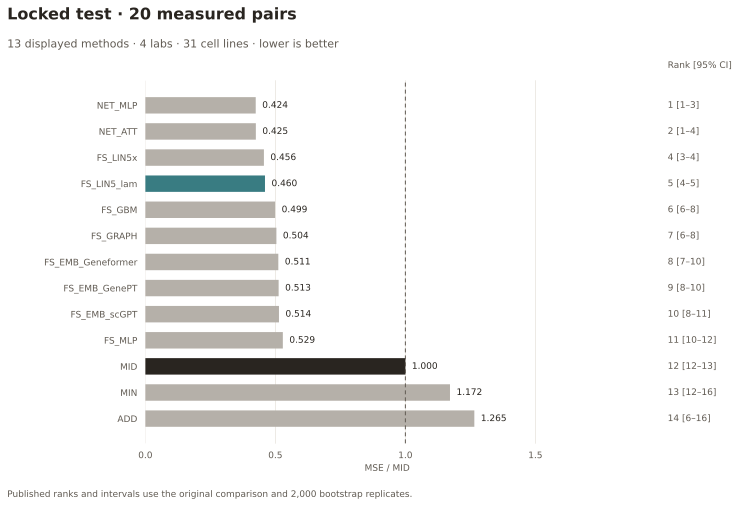
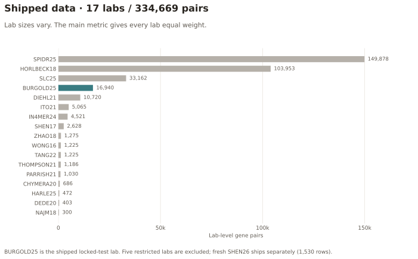

<div align="center">
  
  <h1>Opal-Bench</h1>
  <p>Predict combinatorial CRISPR growth in a lab you have never seen.</p>
</div>

<div align="center">
  <a href="https://thetinyintelligencelab.vercel.app/"></a>
  <a href="LICENSE"></a>
  <a href="DATA_LICENSES.md"></a>
</div>

<p align="center">
  <a href="#how-it-works">Benchmark</a> &middot;
  <a href="#install">Quick start</a> &middot;
  <a href="#results">Results</a> &middot;
  <a href="#submit-a-method">Submit a method</a> &middot;
  <a href="#data-and-reproduction">Data</a> &middot;
  <a href="https://huggingface.co/datasets/TheTinyIntelLab/opal-bench">Hugging Face</a> &middot;
  <a href="#citation">Citation</a>
</p>

Opal-Bench measures how well you can predict pair growth in a CRISPR screen your method hasn't seen. You get the screen's single-gene scores and at most k measured pairs, then predict the rest. Entire labs are held out, so pairs from the target lab can't leak into training through a random split.

The full benchmark covers 22 labs and 411,098 lab-level pairs across CRISPRi, Cas9, paired Cas9, Cas12a and CHyMErA. You can score the 17 shipped labs with NumPy and pandas on a CPU. Five restricted labs are excluded from the source data, but their aggregate evaluation rows remain in the leaderboard.

## How it works

Train on the allowed labs, then use the target screen's singles and k calibration pairs to predict its unmeasured pairs. Each method gets the same calibration draws, and the scorer excludes those pairs from evaluation.


| Track | Evaluation units | Allowed training | Measured pairs, k | Draws |
| --- | --- | --- | --- | --- |
| Development | 18 labs | Other development labs, nested leave-one-lab-out | 0, 10, 20, 50 | 20 |
| Locked test | 4 labs, 31 cell lines | All 18 development labs | 0, 10, 20, 50 | 20 |
| Fresh SHEN26 | 2 cell lines | Every lab in the benchmark table | 0, 5, 20 | 50 |

At k = 0 there is one draw and the whole unit is scored. The main metric is **MSE / MSE(MID)**, geometrically averaged over labs after averaging log ratios over draws and cell lines within each lab. Lower is better; MID is 1. Rank intervals use 2,000 bootstrap replicates over labs, then cell lines where applicable.

All screens share one normalization: counts to CPM, log2 fold change, centering on controls or singles, then division by c = −(the fifth percentile of single-gene log fold changes), floored at 0.1. In these units ADD = sa + sb, MIN = min(sa, sb), and MID = ½(ADD + MIN).

Auxiliary tasks measure zero-shot held-out-lab prediction (`a`), 20-pair calibration (`a_fs20`), held-out genes (`b`), strong-negative-interaction AUROC (`c`) and between-lab reproducibility (`d`). The [full leaderboard](leaderboard/LEADERBOARD.md) includes every track.

## Install

Use Python 3.10 or newer. From this checkout:

```bash
python -m venv .venv
# Activate the environment for your shell, then:
python -m pip install -e ".[test]"
python -X utf8 -m pytest -q
opal-bench-score --help
```

The package is `Opal-Bench`; its Python import is `opal_bench`. Code lives in `src/`. The four tests reproduce shipped baseline rows, the published leaderboard tables and tasks on the 17 shipped labs. The optional Opal re-score needs a separate growth bundle. A full test run takes about two minutes on one CPU.

```bash
opal-bench-score fewshot                        # Shipped dev, test and fresh baselines
opal-bench-score tasks                          # Auxiliary tasks on shipped data
opal-bench-score table leaderboard/rows.csv.gz  # Tables from all published rows
```

## Results

On the locked test, a six-coefficient ridge fitted to 20 target pairs comes close to the larger networks, with overlapping bootstrap rank intervals. That result doesn't carry over to fresh SHEN26. There, Opal refit is the only listed method below MID at k = 20.


### Locked test, k = 20

| Method | MSE / MID | Rank [95% CI] |
| --- | ---: | ---: |
| NET_MLP | 0.424 | 1 [1–3] |
| NET_ATT | 0.425 | 2 [1–4] |
| Opal refit (v1R) | 0.435 | 3 [1–4] |
| Cross-lab ridge (FS_LIN5x) | 0.456 | 4 [3–4] |
| Six-coefficient ridge (FS_LIN5_lam) | 0.460 | 5 [4–5] |
| MID | 1.000 | 12 [12–13] |
| Opal frozen (v1F) | 1.658 | 16 [13–16] |



The figures use the published per-draw rows, including aggregate results for the five restricted labs. You can re-score the built-in rules and few-shot ridge here. The cross-lab learners have published evaluation rows, but their training code isn't included. The [leaderboard](leaderboard/LEADERBOARD.md) records each method's provenance.

### What did not transfer

With no target pairs, every tested learner loses to MID on the locked test. Foundation-model and graph features don't beat the singles-only few-shot ridge, frozen Opal doesn't transfer, and choosing calibration pairs actively performs worse than choosing them at random. On fresh SHEN26 at k = 20, Opal refit scores 0.941 and the small ridge scores 1.046 against MID at 1.000. [Negative results](NEGATIVE_RESULTS.md) records the experiments behind these comparisons.

## Submit a method

Expose a factory that receives allowed training pairs and returns a predictor. The predictor receives labeled calibration pairs and evaluation pairs with `y` removed; return one prediction per evaluation row, or `None` to abstain at an unsupported budget.

```python
import numpy as np


def make_method(train):
    def predict(cal, ev):
        return np.minimum(ev.sa, ev.sb).to_numpy()  # Example: MIN baseline
    return predict
```

```bash
opal-bench-score fewshot --method mypackage.mymodule:make_method --name MYMODEL --rows my_rows.csv.gz
```

Tune only by nested leave-one-lab-out on the allowed training labs. Use no target pair outcomes beyond the k calibration pairs, and never tune on the locked test or SHEN26. Calibration draws are fixed by the published md5 seeds; do not change splits, seeds, k grids or the metric.

To submit, open a pull request with rows covering all 22 labs and a link to your method code. Auxiliary tasks `a`–`c` accept a predictions CSV with `task,lab,key,pred`; `python -m opal_bench.template --help` describes the required rows.

## Data and reproduction

The shipped lab-level table contains **334,669 pairs from 17 labs**. Source sizes vary substantially, so the metric gives each lab equal weight rather than letting the largest screen dominate.



| Path | Contents |
| --- | --- |
| `data/redistributable/bench_pairs.csv.gz` | Lab-level growth scores, gene pairs and single-gene scores |
| `data/redistributable/bench_priors.csv.gz` | STRING combined scores and Ensembl paralog identity |
| `data/redistributable/test_units.csv.gz` | 16,940 cell-line rows for BURGOLD25, HT-29 |
| `data/redistributable/by_source/` | One file for each shipped lab |
| `data/fresh/SHEN26.csv.gz` | 1,530 rows: 765 pairs across HCT116 and GM12878 |
| `leaderboard/rows.csv.gz` | 49,038 per-draw MSE rows for all published methods |

### Score all 22 labs locally

The public checkout covers 16 development labs, BURGOLD25 and fresh SHEN26. ABBVIE25, DU17, HAN17, KLINGBEIL24 and SCHEMATIC25 are excluded because their source terms restrict or don't clearly allow redistribution. Raw-source preprocessing scripts aren't bundled.

If you independently prepare compatible, normalized pair, prior and cell-line tables under the source terms, merge them with the shipped data:

```bash
python -m opal_bench.prepare --extra <dir>/bench_pairs.csv.gz --extra-priors <dir>/bench_priors.csv.gz --test-units <dir>/test_units.csv.gz
```

The scorer uses `data/full/` when it exists, and Git ignores it. The original build-machine replay reproduced the pair and prior tables byte-for-byte; that raw-source workflow isn't part of this checkout. [SHA256SUMS.txt](SHA256SUMS.txt) covers the shipped files.

## Limitations

The locked-test labs were used in earlier zero-shot pilots, so they were held out from few-shot development but are not pristine. SHEN26 was never used during development and provides the fresh check. Its interaction signal is small relative to noise, and model gains there are correspondingly smaller.

Lab agreement is limited: median between-lab correlation is 0.21 across the full benchmark. These scores measure pair-growth prediction under the declared data access rules; they do not establish biological discovery, causal interactions or universal transfer across screens. To our knowledge, this is the first public held-out-lab pair-growth benchmark spanning CRISPRi, Cas9, Cas12a and CHyMErA under one normalization. Related work includes SLKB (NAR 2024) and MLEC-iGeneCombo (2025).

## Documentation and repository

- [Full leaderboard](leaderboard/LEADERBOARD.md) records results, ranks and method provenance.
- [Dataset card](DATASET_CARD.md) documents the data configurations and schemas.
- [Source licenses](DATA_LICENSES.md) records the redistribution audit for each lab.
- [Negative results](NEGATIVE_RESULTS.md) preserves unsuccessful experiments.
- `src/` contains scoring, baselines, metrics, data loading and adapters; `tests/` contains frozen numerical expectations.
- `tools/plot_readme.py` regenerates the four benchmark figures from shipped evidence.

Figures are saved as SVG under `images/`, with source hashes and plotted values in [figure_data.json](images/figure_data.json). To regenerate them, install Matplotlib in your development environment and run `python tools/plot_readme.py`. The original PNG logo and lab/license badges follow the [Opal repository](https://github.com/TheTinyIntelLab/opal).

## License

Original code is [MIT licensed](LICENSE). Data keep their [per-source licenses](DATA_LICENSES.md), including GPL-3.0-or-later terms for the SLKB-derived labs. A code license does not override a source dataset's terms. Restricted source tables and trained checkpoints are not included.

## Citation

Use [CITATION.cff](CITATION.cff) to cite Opal-Bench, and cite the original data sources you use.

> Prakash, A. V. (2026). Opal-Bench: a held-out-lab benchmark for combinatorial CRISPR growth prediction. The Tiny Intelligence Lab.
